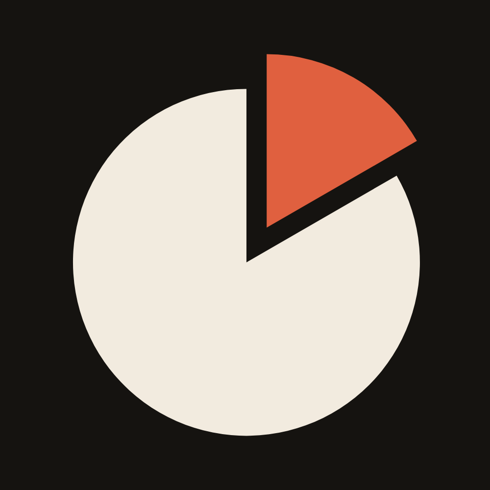

# Rheilon contracts

Smart contracts for [Rheilon](https://rheilon.com): a shared stock account for a crew of 2 to 10 people on
Robinhood Chain (chain ID 4663). Members pool USDG, pitch trades in Robinhood Stock Tokens, vote with their own
wallets, and can leave with their share whenever they want (money added in the last hour stays in until the hour is
up).

The contracts have no owner, no admin keys, no pause and no upgrade path.

## Contents

| Path | What it is |
| --- | --- |
| `contracts/RheilonAccount.sol` | One crew's account: deposits, joins, votes, trades, withdrawals |
| `contracts/RheilonFactory.sol` | Creates crews and lists them |
| `contracts/RheilonAccountDeployer.sol` | Holds the crew code for the factory (v2: the code is too big to sit in the factory itself) |
| `contracts/RheilonRegistry.sol` | Fixed settings crews point at: USDG, supported stocks, oracle, swap route, fees, beta cap |
| `contracts/oracles/ChainlinkOracle.sol` | Values Stock Tokens in USDG with Chainlink feeds |
| `contracts/adapters/UniswapV3Adapter.sol` | Swaps through fixed Uniswap v3 pools |
| `contracts/RheilonLaunch.sol` | One-shot deployer for all of the above on a fresh chain (used for v1 and the fork tests; v2 reused v1's registry, oracle and adapter) |
| `contracts/mocks/` | Test-only contracts (never deployed to mainnet) |
| `test/` | Unit tests, integration tests and fuzz tests |
| `test-fork/` | Tests against a local copy of Robinhood Chain mainnet |
| `scripts/check-deployed.js` | Compares the code on Robinhood Chain with this repository, v1 and v2 |
| `deployments/robinhood-mainnet.json` | Deployed addresses and every external address used (tokens, feeds, pools) |
| `verification/` | The flattened sources and constructor arguments used to verify on the explorer |
| `docs/` | How a crew works, the HEY Research Lab review, the v1 self-review, and $HEIL perks |

## Deployed

Contracts are immutable, so the fixed version is a second factory. New crews are created through v2. Crews created
by v1 keep working and every member can withdraw or leave, but rheilon.com no longer offers joins into them.

**v2** (current, [security review by HEY Research Lab](docs/review-v2.md), final commit not retested)

| Contract | Address |
| --- | --- |
| RheilonFactory | [`0xAfb187494ebb15aD8CC51A1e350747AB8021Fa41`](https://robinhoodchain.blockscout.com/address/0xAfb187494ebb15aD8CC51A1e350747AB8021Fa41) |
| RheilonAccountDeployer (created by the factory, answers only to it) | [`0xD392e27AB8C48aAeeb052F4d50740ccF2701b6BE`](https://robinhoodchain.blockscout.com/address/0xD392e27AB8C48aAeeb052F4d50740ccF2701b6BE) |

**Shared by v1 and v2** (unchanged)

| Contract | Address |
| --- | --- |
| RheilonRegistry | [`0x91D1244361560Ca7E1BFFA60FE29981ED2371A63`](https://robinhoodchain.blockscout.com/address/0x91D1244361560Ca7E1BFFA60FE29981ED2371A63) |
| ChainlinkOracle | [`0xc3573a8f0235E12C40667f9d3cCd7251591618a3`](https://robinhoodchain.blockscout.com/address/0xc3573a8f0235E12C40667f9d3cCd7251591618a3) |
| UniswapV3Adapter | [`0x2d2bF902Ee7F51769F8B10D8da13DE68aadD6181`](https://robinhoodchain.blockscout.com/address/0x2d2bF902Ee7F51769F8B10D8da13DE68aadD6181) |
| Treasury (receives fees) | [`0xD8939e5c33904aAF7098881F5e052616Ce40b086`](https://robinhoodchain.blockscout.com/address/0xD8939e5c33904aAF7098881F5e052616Ce40b086) |

**v1** (source: [`verification/RheilonLaunch.flat.sol`](verification/RheilonLaunch.flat.sol), or the code at [`2e5f174`](https://github.com/rheilonfinance/rheilon-contracts/tree/2e5f174))

| Contract | Address |
| --- | --- |
| RheilonLaunch | [`0xd8f941e1B65BEDb7f7a3bCCdE26e244347FcFC34`](https://robinhoodchain.blockscout.com/address/0xd8f941e1B65BEDb7f7a3bCCdE26e244347FcFC34) |
| RheilonFactory | [`0x62306E1C55AE3CA8D6CE874c275eeB3C16c349A8`](https://robinhoodchain.blockscout.com/address/0x62306E1C55AE3CA8D6CE874c275eeB3C16c349A8) |

Everything above was deployed from [`0x64438E23582A85e5f764CdD28AEC4099bC7C7604`](https://robinhoodchain.blockscout.com/address/0x64438E23582A85e5f764CdD28AEC4099bC7C7604).
Compiler for both versions: solc 0.8.24, optimizer 200 runs, EVM version cancun. The v1 contracts are verified
(exact match) on Blockscout and Sourcify; the v2 factory and deployer are verified too (see
[`verification/`](verification/README.md)). Every crew is a `RheilonAccount` created by a factory.

Supported Stock Tokens: NVDA, AAPL, TSLA, MSFT, AMZN, GOOGL, META, QQQ. Token, Chainlink feed and Uniswap pool for
each are in `deployments/robinhood-mainnet.json`.

## $HEIL



Rheilon's community token, launched on [Pons](https://ponsfamily.com). It was deployed from the same wallet that
deployed every contract above. This is the only $HEIL, anything else using the name isn't us.

<br clear="left">

| Token | Address |
| --- | --- |
| $HEIL | [`0xE1a8Ea885047572986f80019B1196d6088DC555e`](https://robinhoodchain.blockscout.com/token/0xE1a8Ea885047572986f80019B1196d6088DC555e) |

The image above is the same file as the token image on Pons (`ipfs://bafkreih4ztbmbdilrhfsqv76keffz7qf3qngrnraxwf7golxh2a5s5muyq`,
stored in the token contract). $HEIL is not a share of any crew and has no claim on fees, profits or votes, and the
contracts in this repository don't use it. Live price and curve progress are on [rheilon.com/heil](https://rheilon.com/heil).

What $HEIL does on the website, all paid by burning it and none of it touching a crew's money:

- **Holder badge** for wallets holding 500,000 $HEIL.
- **Feature your crew**: burn $5 of $HEIL to show a crew first in Discover for 7 days.
- **The Rheilon agent on X**: link your X and burn $10 of $HEIL in total, then mention @rheilonfinance with any
  question and it replies on X. It can't move money or trade for anyone.

How burns are checked and valued, and what the agent will and won't do: [`docs/heil-perks.md`](docs/heil-perks.md).

## How a crew works (v2)

- 2 to 10 seats. Members add USDG and receive shares at the account's current value.
- Private crews add members by vote. Open crews let anyone join while seats are free; a join agrees to the pitches
  already passed, newcomers vote after 3 days, and open crews vote by shares. An open crew can vote to close itself
  to joins.
- Trades are proposals. They pass at two thirds by default; unless every member signed, a 12-hour cool-off follows so
  anyone who disagrees can leave first. If a signer pulls out, or the voters change, the pitch has to pass again.
- Each trade carries the minimum the crew must receive, and can't come back more than 3% under the Chainlink price.
- Withdrawing and leaving need no vote and no price: you get your share of every asset the crew holds. Money added in
  the last hour stays in until the hour is up.

More detail in [`docs/how-it-works.md`](docs/how-it-works.md).

## Fees

| Action | Fee |
| --- | --- |
| Trade | 0.20%, taken in USDG |
| Joining an open crew | 0.20% of the USDG brought in |
| Creating a crew, adding money, withdrawing, leaving | Free |

The registry stores the fee and every account also caps it at 0.20% (`MAX_FEE_BPS = 20`), so it can't go up.

## Run the tests

Node 18 or newer.

```bash
npm install
npm test             # unit, integration and fuzz tests
npm run test:fuzz    # longer fuzz run: 16 campaigns x 400 random steps
npm run test:fork    # forks Robinhood Chain mainnet in memory and runs real trades on the copy
```

## Check the deployed code yourself

```bash
npm run check
```

Compiles this repository and compares it with the bytecode on Robinhood Chain: v2 and the shared contracts against
`contracts/`, v1 against the flattened source it was deployed from, and every crew both factories have created. Only immutables (values set at deployment) and metadata hashes are ignored. Set
`RH_RPC` to use your own RPC.

## Security

- No owner, admin, pause or upgrade on any contract. Nobody can move a crew's funds or change its rules from outside.
- Exits never depend on the price oracle or a vote.
- Fees are capped in code at 0.20%.
- Beta: each crew can hold up to $25,000.
- **Security review by HEY Research Lab, final commit not retested.** Findings, fixes and tests are in
  [`docs/review-v2.md`](docs/review-v2.md). The two Medium findings in v1 are published as advisories in this
  repository's Security tab, with v2 as the patched version.
- Our own earlier self-review of v1 is in [`docs/security-review.md`](docs/security-review.md).

Found a problem? Please report it privately through this repository's **Security** tab (private vulnerability
reporting), not in a public issue.

## Disclaimer

Experimental software, provided as is. Not investment advice. Stock Tokens are issued by Robinhood and give price
exposure, not shareholder rights; their availability depends on where you live. Rheilon is independent and not
affiliated with Robinhood Markets, Inc.

## License

[MIT](LICENSE)
